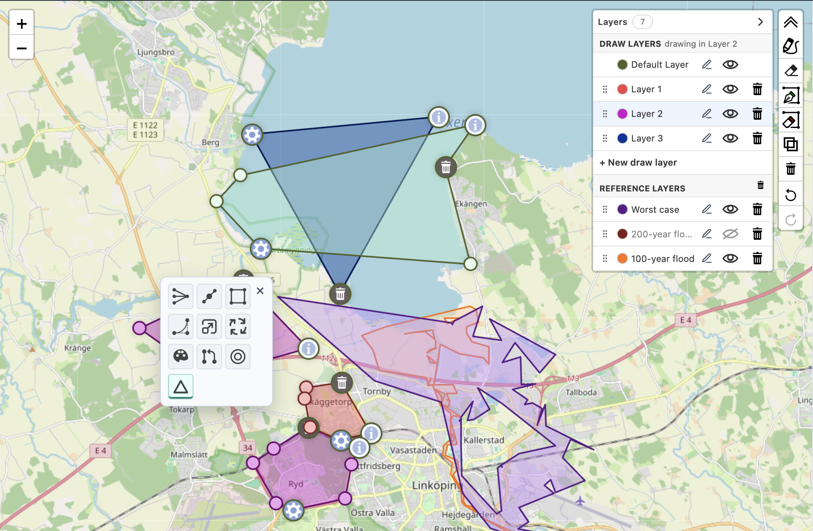
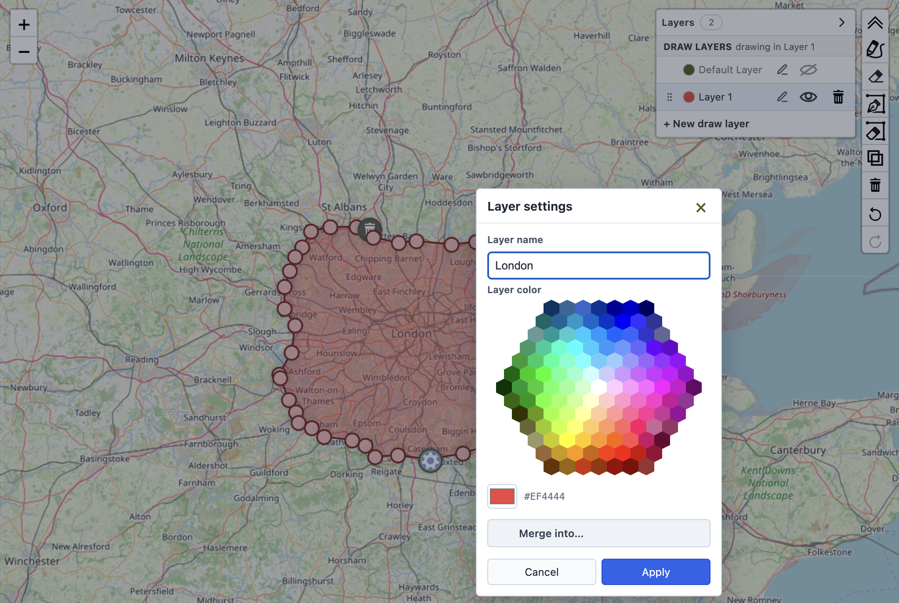
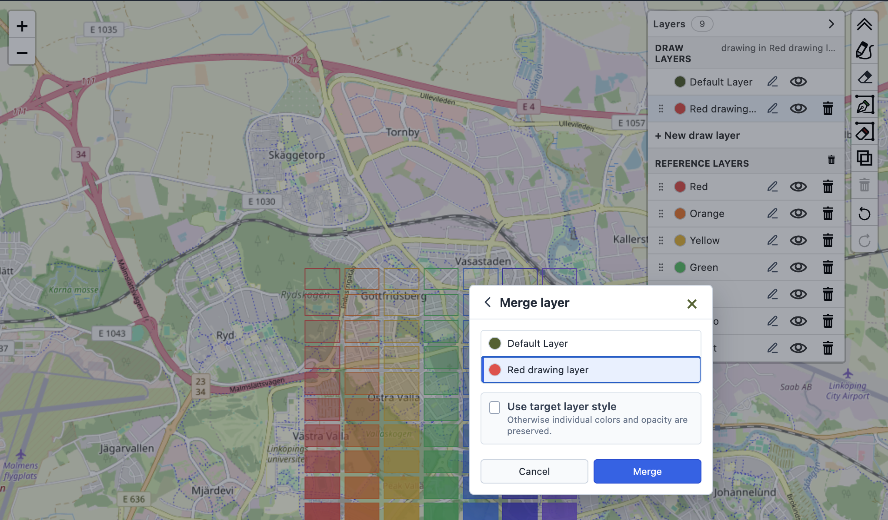

# Layer Management

Leaflet.Polydraw separates the layer that owns a polygon from the polygon's geometry and feature metadata. This makes it possible to keep user drawings, imported datasets, and contextual geometry independent while using the same editing tools.

## Layer Roles

Every layer has one of two roles:

- **Draw**: can become the active target for freehand and point-to-point drawing. The built-in `default` layer is always available as a draw layer.
- **Reference**: cannot become the active drawing target. Reference geometry can still be editable, readonly, or static through its interaction policy.

Automatic creation, drag, and marker-drag merges only inspect polygons in the same layer. Two overlapping polygons in different layers therefore remain separate until they are explicitly moved or their layers are merged.

[](https://raw.githubusercontent.com/AndreasOlausson/leaflet-polydraw/main/Leaflet.Polydraw/docs/images/layer-workflows-overview.png)

## Enable the Panel

The built-in layer panel is opt-in so upgrading applications retain the existing single-layer interface. When enabled, it starts expanded by default; it can instead start collapsed or be replaced by application-owned UI.

```typescript
const polydraw = L.control.polydraw({
  config: {
    layerPanel: {
      enabled: true,
      initialState: "expanded",
      merge: {
        allowReferenceSources: false,
      },
    },
  },
}).addTo(map);
```

The panel separates draw and reference layers. It supports:

- selecting the active draw layer
- creating, naming, coloring, showing, hiding, ordering, and deleting layers
- deleting all reference layers as one undoable action
- merging a complete populated layer into a draw layer
- collapsing the panel while preserving its state

Generated draw layers use a deterministic 21-color palette before colors repeat.

[](https://raw.githubusercontent.com/AndreasOlausson/leaflet-polydraw/main/Leaflet.Polydraw/docs/images/layer-settings.png)

## Create Draw Layers

`createDrawLayer()` creates an editable layer and makes it the active drawing target.

```typescript
const surveyLayer = polydraw.createDrawLayer({
  id: "survey-edits",
  label: "Survey edits",
  color: "#ef4444",
});

console.log(polydraw.getActiveLayerId()); // "survey-edits"
```

When `id`, `label`, or `color` is omitted, Polydraw generates a `Layer N` name and the next palette color.

## Add Reference Geometry

Assign imported polygons or GeoJSON to a reference layer with a layer descriptor. Interaction and role are independent: a reference layer may be editable without becoming a drawing target.

```typescript
await polydraw.addPredefinedGeoJSONs(features, {
  layer: {
    id: "flood-risk",
    label: "Flood risk",
    role: "reference",
    interaction: "readonly",
    color: "#2563eb",
    metadata: { source: "risk-service" },
  },
});
```

Use `interaction: "editable"` when users should be able to drag the polygon or its vertices. Use `readonly` for visible/selectable geometry without edit handles, or `static` for non-interactive geometry. Static layers are hidden from the panel unless `panel: "visible"` is set explicitly.

## Move One Polygon

The built-in polygon action is also opt-in through `polygonTools.moveToLayer.enabled`. It can move the selected polygon to an existing draw layer or create and name a new one.

```typescript
const polydraw = L.control.polydraw({
  config: {
    polygonTools: {
      moveToLayer: { enabled: true },
    },
  },
}).addTo(map);
```

The operation is undoable. If `mergePolygons` is enabled, a moved polygon is unioned with overlapping polygons in the target layer. Moving the final polygon out of a non-default draw layer removes the empty source layer.

Applications with their own UI can use `moveFeatureGroupToLayer(featureGroup, targetLayerId)` for direct reassignment. This low-level API does not union geometry; use the built-in polygon action or `mergeLayerInto()` when target-layer overlaps should be merged.

## Merge a Complete Layer

The layer settings dialog can merge every polygon from a populated source into a target draw layer. When only one target exists, it is selected automatically.

[](https://raw.githubusercontent.com/AndreasOlausson/leaflet-polydraw/main/Leaflet.Polydraw/docs/images/layer-merge.png)

```typescript
await polydraw.mergeLayerInto("survey-edits", "default");
```

Whole-layer merge has these semantics:

- the target must be a draw layer
- overlaps are unioned when `mergePolygons` is enabled
- the non-default source layer is removed after success
- the complete operation creates one undo step
- the operation is atomic; any failure restores geometry, layers, and history
- per-polygon style overrides are preserved by default

To replace individual colors, fill opacity, stroke opacity, and weight with the target layer style:

```typescript
await polydraw.mergeLayerInto("survey-edits", "default", {
  useTargetStyle: true,
});
```

Reference layers are disabled as merge sources by default. Enable them explicitly when imported geometry should be convertible into a draw layer:

```typescript
const polydraw = L.control.polydraw({
  config: {
    layerPanel: {
      merge: { allowReferenceSources: true },
    },
  },
}).addTo(map);

await polydraw.mergeLayerInto("flood-risk", "default", {
  useTargetStyle: true,
});
```

Reference layers can never be merge targets.

## Update Layer State

The public API can drive a custom layer interface:

```typescript
polydraw.updateLayer("survey-edits", {
  label: "Reviewed survey edits",
  color: "#16a34a",
  visibility: true,
  interaction: "editable",
  metadata: { owner: "gis-team" },
});

polydraw.setLayerVisibility("flood-risk", false);
polydraw.setActiveLayer("survey-edits");
polydraw.moveLayerToIndex("survey-edits", 1);
```

The most commonly used methods are:

- Read: `getAllLayers()`, `getLayerById()`, `getFeatureGroupsByLayer()`, `getLayerForFeatureGroup()`
- Create/update: `createDrawLayer()`, `createLayer()`, `ensureLayer()`, `updateLayer()`
- State: `setActiveLayer()`, `setLayerVisibility()`, `setLayerColor()`, `setLayerInteraction()`, `setLayerMetadata()`
- Move/merge: `moveFeatureGroupToLayer()`, `mergeLayerInto()`
- Order/delete: `reorderLayer()`, `moveLayerToIndex()`, `setLayerOrder()`, `deleteLayer()`

See [API.md](API.md) for exact signatures and [CONFIGURATION.md](CONFIGURATION.md) for every configuration property.
